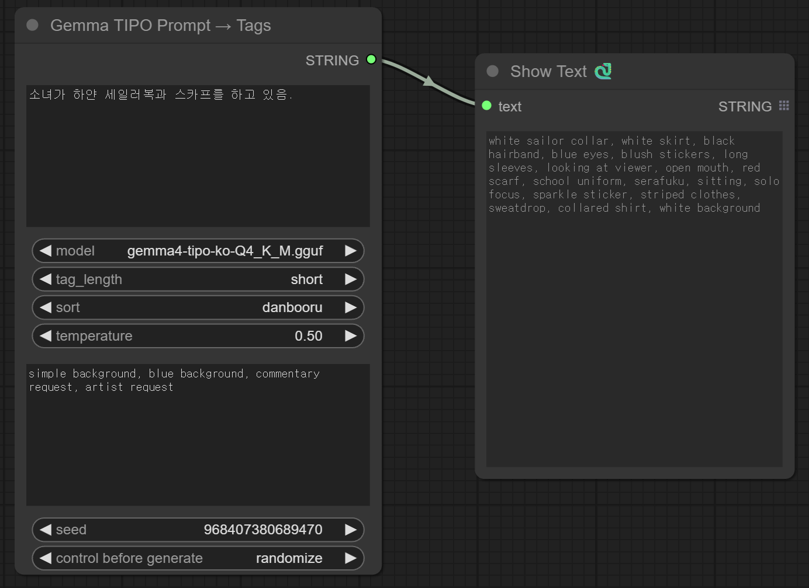
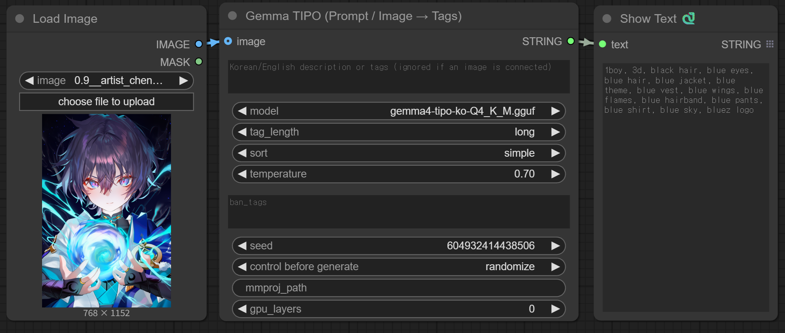

# RS-Seasonal-Prompt-Generator

*[English](README.md) | 한국어*

 CSV 데이터에서 패션 아이템·배경·날씨·시간·추가 상황 디테일을 무작위로
 조합해 계절별 패션 프롬프트를 생성합니다.

> **v2.9.0**: 한국어/영어 설명을 이해하는 RS AI Prompt Writer를 추가했습니다.
> 계절 프롬프트의 시드 재현성·독립 의상 토글·CSV 분류와
> 텍스트/비전 태그 정리를 수정했습니다. 비전은 짝을 이루는 학습 모델과
> mmproj를 사용하며 CUDA / Vulkan / Metal 및 CPU 폴백을 지원합니다.
> **`gpu_layers=0`은 CPU 유지, `-1`은 GPU 자동 선택/전 레이어입니다.**
> 모델·실행 파일은 다운로드와 설치가 끝나야 캐시에 반영됩니다.
> 자세한 내용은 [변경 로그](Update_log_KOR.txt)를 참고하세요.

이 팩은 **독립적인 세 개의 노드**를 제공합니다(카테고리: `prompt`):
1) Seasonal Fashion Prompt Generator (CSV, 의존성 없음), 2) Gemma TIPO
(Prompt / Image → Tags), 3) RS AI Prompt Writer (Korean / English → Prompt). 이 폴더를 `ComfyUI/custom_nodes/` 에
클론/복사한 뒤 ComfyUI를 재시작하면 설치됩니다. 각 노드는 `STRING`
을 출력하며 서로 연결(체이닝)할 수 있습니다.

## AI로 자연스러운 프롬프트 작성하기

[VRS-INT](vrs_int/README.md)는 별도로 실행하는 실험용 기억 구축·이미지 참고 태그 추천기입니다.
**코드를 배포하고 자료는 사용자가 취향에 맞게 선택해 구성하는 방식**입니다.
이미지·태그·인코더 가중치는 포함하지 않으며, 로컬 이미지 묶음별 구축·추가를 지원합니다.
작가 후보는 창작 참고용이며 입력 이미지의 실제 작가를 확인했다는 뜻이 아닙니다.
[이미지·텍스트 쌍 예제](examples/vrs-int/README.md)에 JSONL 템플릿, 이미지별 JSON을
묶는 스크립트, 모델 없는 입력 검사, 구축·추가·추천 명령을 제공합니다.
자연어 설명은 메타데이터로 보존하며, 현재 추천에는 분류된 태그 배열을 사용합니다.

기존 단보루 관측에 VRS 판정을 적용한 별도 [4070 GPU 연관도 실험](experiments/README.md)도
있습니다. [전체 자료 구축](experiments/FULL_DATASET.md)과
[보류 이미지 128장의 태그 추천 검사](experiments/IMAGE_RETRIEVAL.md)를 진행했습니다.
이미지 검사에서 과거 특징 캐시의 픽셀 변환 결함이 확인돼 별도 수정 비교를 했습니다.
이제 별도 [이미지 참고 → 새 프롬프트 생성 실험](experiments/IMAGE_PROMPT.md)에서
수정 이미지 인덱스 → VRS 참고 태그 → 계절 CSV → Writer까지 연결했습니다.
태그 정답 복원이 아닌 새 장면 작성이 목적이며, ComfyUI 노드에는 아직 연결하지 않았습니다.

“하얀 셔츠와 파란 치마를 입은 여성이 공원에 서 있다”처럼 장면을 설명하려면
**RS AI Prompt Writer (Korean / English → Prompt)**를 사용하세요. 지시를 따르는
범용 모델로 핵심 설정을 유지하면서 프롬프트를 작성합니다. 기존 TIPO는 태그 확장과
이미지 입력용으로 유지합니다. TIPO는 지시를 강화해도 입력 내용을 빠뜨리거나 바꾸는
경우가 실제 검사에서 확인되었습니다.

1. `prompt` 카테고리에서 **RS AI Prompt Writer** 노드를 추가합니다.
2. `prompt`에 한국어/영어 설명을 쓰거나 Seasonal Fashion Prompt Generator의
   `STRING` 출력을 연결합니다.
3. `model`은 자동으로 둡니다. 첫 실행에는 Unsloth의 Qwen3-4B-Instruct-2507
   Q4_K_M 파일 약 **2.50 GB**를 받습니다. 리비전을 고정하고 SHA-256을 검증합니다.
   로컬에서 실행하며 API 키나 유료 API 호출은 필요하지 않습니다.
4. `tags`는 쉼표로 구분한 영어 태그, `natural_language`는 자연스러운 영어 문단을
   출력합니다. 결과를 **Preview as Text** 또는 이미지 모델의 텍스트 인코더에 연결합니다.
5. 처음에는 `creativity=balanced`, `length=medium`, `temperature=0.6`으로 시작합니다.

| 설정 | 동작 |
| --- | --- |
| `faithful` | 입력을 번역·재구성하고 새로운 세부 설정은 만들지 않도록 지시합니다. |
| `balanced` | 지정된 설정을 유지하고 어울리는 조명·분위기·구도를 보충합니다. |
| `creative` | 명시한 요구사항을 유지하면서 미지정 부분을 풍부하게 만듭니다. |
| `length` | short / medium / long 목표 길이. 입력 내용 보존을 우선합니다. |
| `seed` | 동일 모델·실행 환경에서 샘플링을 재현합니다. 하드웨어·빌드가 다르면 결과도 달라질 수 있습니다. |
| `gpu_layers` | `-1`(기본값): GPU 전 레이어. 호환되는 llama-cpp-python GPU 빌드가 필요합니다. `0`은 명시적 CPU 선택이며 자동 CPU 재시도는 없습니다. |
| `cpu_threads` | 기본값 `2`: 생성·입력 처리의 CPU 보조 스레드 수. 데스크톱 응답성을 위해 낮게 유지합니다. |

위 설정은 모델에 주는 지시이며 의미 보존을 보장하지는 않습니다. 중요한 요구사항은
출력에서 확인하세요. 추가 GPU 검사에서는 우산만 명시한 입력에 비 오는 날씨를
덧붙이는 등 balanced 모드가 미지정 설정을 추가하는 사례가 남았습니다.
문장형에 단편적인 구절이나 작은 문법 오류가 섞일 수도 있습니다.
이 노드는 텍스트를 받으며 이미지 입력은 Gemma TIPO를 사용합니다.
사용자 모델은 `ComfyUI/models/gguf/`에 두며 채팅 템플릿이 있는 지시 모델을 사용하세요.
노드 등록만으로는 모델을 다운로드하지 않습니다. 생성 실패 시 원문을 성공 결과처럼
반환하지 않고 노드 오류를 표시합니다. 기존 CUDA 휠이 라이브러리를 찾지 못하면
**ComfyUI와 같은 Python 환경**에서 GPU 휠과 맞는 런타임을 사용해야 합니다.
`RS_TIPO_FORCE_CPU=1`은 이 노드에도 적용되지만 깨진 휠 자체를 복구하지는 않습니다.
GPU 요청 시 CPU 전용 빌드는 모델 다운로드 전에 거부합니다. CPU 실행을 원할
때에만 `gpu_layers=0`을 선택하세요. GPU가 여러 개면 Python 시작 전에
`CUDA_VISIBLE_DEVICES`를 원하는 GPU UUID로 지정할 수 있습니다.
이 환경 변수는 ComfyUI 프로세스 전체에 적용됩니다.

기본 모델 출처: [Qwen 원본](https://huggingface.co/Qwen/Qwen3-4B-Instruct-2507),
[Unsloth GGUF](https://huggingface.co/unsloth/Qwen3-4B-Instruct-2507-GGUF), Apache-2.0.
고정 리비전 `a06e946bb6b655725eafa393f4a9745d460374c9`, 파일
`Qwen3-4B-Instruct-2507-Q4_K_M.gguf`, SHA-256
`3605803b982cb64aead44f6c1b2ae36e3acdb41d8e46c8a94c6533bc4c67e597`.

## 쇼케이스



한국어 자연어 입력 → 깔끔한 영어 Danbooru 태그 출력:

> **입력:** `소녀가 하얀 세일러복과 스카프를 하고 있음.`
>
> **출력:** `white sailor collar, white skirt, black hairband, blue eyes,
> blush stickers, long sleeves, looking at viewer, open mouth, red scarf,
> school uniform, serafuku, sitting, solo focus, sparkle sticker, striped
> clothes, sweatdrop, collared shirt, white background`

그리고 **비전 모드** — 이미지를 연결하면 그럴듯하게 확장된 Danbooru
태그 세트가 나옵니다(TIPO식, 정확한 라벨링이 아님):



## 노드 1 — Seasonal Fashion Prompt Generator

원래의 생성기입니다. `season` 을 고르고 패션 / 배경 / 날씨 / 포즈 /
상황 옵션을 토글하면, 번들된 CSV 데이터에서 무작위로 조합한
콤마 구분 프롬프트를 반환합니다. **의존성 없음** — 아무것도
설치하지 않고 모델도 실행하지 않습니다.

같은 입력과 `seed`는 같은 CSV 프롬프트를 재현하며 `seed=0`도 포함됩니다.
요청마다 별도 난수 생성기를 사용합니다. 재현할 때는 ComfyUI의 시드 동작을
**fixed**로 두세요. CSV나 생성기 버전을 바꾸면 선택 결과는 달라질 수 있습니다.
상의·하의 토글은 각각 독립적으로 동작합니다. 원피스가 켜져 있으면 상하의의
대안으로 선택되며 상하의와 동시에 선택되지 않습니다.
추가 상황 CSV의 조건은 `|`로 대안을, `&`로 동시에 필요한 조건을
나타냅니다. 예를 들어 `misty&forest`는 안개와 숲을 모두 요구합니다.

## 노드 2 — Gemma TIPO (Prompt / Image → Tags)

하나로 통합된 노드입니다. **`image` 를 연결하면 → 비전 모드**
(이미지를 Gemma-4 비전 = llama.cpp `mtmd` + 자동 다운로드된
**co-trained 비전 모델 + mmproj** 로 캡션; `gpu_layers=-1`이면 GPU 자동 선택).
**이미지 없음 → 텍스트 모드**(`prompt`, 한국어/영어 자연어 또는
태그를 `llama-cpp-python` 으로 in-process 확장). 어느 쪽이든 출력은
동일한 `kgen.formatter` 후처리(정렬 / 중복 제거 / 중복 일반태그 제거 /
인원수 충돌 정리)를 거칩니다.

> ⚠️ **비전 모드는 TIPO식이며, 엄밀한 1:1 태거가 아닙니다.**
> co-trained 비전 모델 + mmproj 로 이미지의 핵심 내용을 그림에서
> 가져오지만, 그 위에 **그럴듯하게 확장**해 더 풍부한 Danbooru 태그
> 세트를 만듭니다(TIPO식 창의적 업샘플링): 이미지에 그대로 있지 않은
> 태그가 일부 포함되고 `seed` 에 따라 실행마다 달라집니다. 레퍼런스
> 이미지를 다양한 text-to-image 프롬프트로 바꾸는 데 좋습니다 —
> 정확하고 충실한 라벨링이 필요하면 전용 태거를 쓰세요.

텍스트 모드는 태그뿐 아니라 **한국어 또는 영어 자연어**도 받습니다:

| 입력 | 출력 (예시) |
| --- | --- |
| `spring, white blouse, pleated skirt, park` | `spring, white blouse, pleated skirt, park, outdoors, school uniform, long sleeves, sitting, solo, …` |
| `빨간 원피스, 밀짚모자, 해변` (한국어) | `straw hat, red one-piece swimsuit, sun hat, beach, ocean, swimsuit, outdoors, …` |

입력:
- `prompt`: 변환할 텍스트(한국어/영어 자연어 또는 태그).
- `model`: **`ComfyUI/models/gguf/`** 에서 찾은 `*.gguf` 파일
  드롭다운. `(auto: download default)` 를 고르면 기본 모델
  (`gemma4-tipo-ko-v2-Q4_K_M.gguf`,
  [`raspie/gemma4-tipo-ko-gguf`](https://huggingface.co/raspie/gemma4-tipo-ko-gguf))
  을 최초 사용 시 해당 폴더로 다운로드합니다 — 다운로드 중
  **노드에 진행 바가 표시**되며 이후 재사용(다시 다운로드하지
  않음). 또는 직접 만든 `.gguf` 를 `ComfyUI/models/gguf/` 에 넣고
  선택할 수 있습니다(새 파일을 보려면 노드 목록을 새로고침).
- `tag_length`: 목표 상세도(`very_short` … `very_long`).
- `sort`: `kgen.formatter` 가 적용하는 프롬프트 정렬 프리셋(태그는
  special/characters/copyrights/artist/general/quality/meta/rating
  로 분류됨):
  - `danbooru` (기본): artist, rating, special, characters,
    copyrights, general, quality, meta.
  - `quality_first`: quality 태그를 앞으로.
  - `artist_first`: artist/character 를 앞으로.
  - `general_only`: special + characters + general 태그만 유지.
  - `simple`: special, rating, general 만.
- `temperature`: 샘플링 temperature.
- `ban_tags`: 결과에서 제거할 콤마 구분 태그.
- `seed`: 변형을 위해 확장을 바꿉니다.
- *(선택)* `image`: ComfyUI IMAGE를 연결하면 **비전 모드**(이미지
  → 태그)로 전환됩니다. **완전 자동** — 최초 비전 사용 시 OS/아키텍처와
  GPU에 맞는 프리빌트 llama.cpp mtmd 바이너리(Windows/NVIDIA → CUDA +
  cudart; Linux/NVIDIA·AMD/Intel → Vulkan; macOS → Metal; 그 외 CPU,
  빌드 불필요)와 트레인된 비전 모델 + mmproj를 자동 다운로드합니다.
  수동으로 설치하거나 설정할 것이 없습니다.
- *(선택, 비전 전용)* `mmproj_path`: **비워 두세요** — 트레인된 비전
  mmproj가 자동 다운로드됩니다(비전 모델과 페어). 직접 만든 mmproj를
  가리킬 때만 설정하세요.
- *(선택, 두 모드 공통)* `gpu_layers`: **`0` = CPU**(기본값, 저장된
  워크플로 호환), **`-1` = GPU 자동 선택/전 레이어**, 양수 = 레이어 수.
  텍스트는 GPU 지원 `llama-cpp-python` 빌드가 필요합니다. 비전에서 GPU
  초기화·추론에 실패하면 CPU로 재시도합니다. `RS_TIPO_FORCE_CPU=1`은
  두 모드 모두 CPU 강제, `LLAMA_MTMD_CLI`는 로컬 실행 파일 경로입니다.
  CPU 모드에서는 비전 프로젝터의 GPU 오프로드도 끕니다.

참고:
- 설명이 길고 자세할수록 더 많고 더 정확한 태그가 나옵니다.
- 한국어 설명은 성공한 태그 출력에 섞이지 않습니다. 기존의 콤마 구분
  영어 입력 태그는 먼저 보존한 뒤 정리합니다.
- 금지 태그는 대소문자·공백/밑줄 차이를 무시합니다. 선택적인 카테고리
  정렬 라이브러리가 없어도 금지 태그와 중복 제거는 적용됩니다.
- 토큰 절약을 위해 중복 일반 태그는 제거됩니다: 같은 핵심 명사를
  가진 더 구체적인 태그(예: `white skirt`)가 있으면 단순 `skirt` 는
  제거됩니다. `dress`/`dress shirt` 처럼 구분되는 태그는 유지됩니다.
- 충돌하는 인원수 태그는 그룹별로 정리됩니다: `1girl` 이 있으면
  `4girls` / `multiple girls` 는 제거(`1girl` + `1boy` 는 유지 —
  그룹은 독립적).
- 의존성·모델·추론 실패 시 텍스트는 원래 프롬프트, 비전은 빈 문자열을
  반환합니다. `[TIPO]` / `[TIPO-V]` 콘솔 로그로 폴백과 생성 성공을
  구분하세요. 비전은 한 장만 받으므로 배치는 한 장을 선택해 연결합니다.
- 다운로드는 임시 파일을 거치며 빈 파일과 불완전한 전송을 거부합니다.
  이는 전송 완료 검사이며 암호학적 모델 무결성 검증은 아닙니다.

### 지원 환경 및 요구사항

| | |
| --- | --- |
| **OS** | Windows / Linux / macOS — ComfyUI가 동작하고 `llama-cpp-python` 휠이 존재하는 모든 환경(x86-64, Apple Silicon/arm64) |
| **노드 1 (Seasonal)** | 모든 ComfyUI 설치. 의존성 없음, 모델 없음. |
| **노드 2 (Gemma TIPO)** | 비전: `gpu_layers=-1`에서 GPU 자동 선택(CUDA / Vulkan / Metal), CPU 폴백. 텍스트: 기본 CPU(GPU는 CUDA `llama-cpp-python` 빌드로). |
| **RAM** | 최소 ~8 GB (4-bit 모델에 ≈5 GB 사용) · 16 GB 이상 권장 |
| **디스크** | 텍스트 ~4 GB(3.2 GB GGUF + 의존성); 비전은 추가로 ~3.2 GB 비전 GGUF + ~1 GB mmproj + GPU 프리빌트(최초 비전 사용 시 1회) |
| **속도** | **비전**은 `gpu_layers=-1`에서 GPU 사용 가능; 속도는 하드웨어에 따라 다름. **텍스트**는 `llama-cpp-python` in-process(기본 CPU 휠이라 느림; 속도는 GPU 빌드 설치). |
| **Python** | ComfyUI 내장 환경; `llama-cpp-python >= 0.3.23`(자동 설치/업그레이드, 1회 재시작 안내) |

### 설치 (노드 2 전용)

**수동 설치가 필요 없습니다.** 노드 2를 실제로 처음 실행할 때
필요한 의존성을 활성 환경에 자동 설치합니다: 정렬용 `tipo-kgen`,
**텍스트 모드에서만** `llama-cpp-python` **>= 0.3.23** 프리빌트 휠.
자동 설치는 llama-cpp-python 소스 빌드를 시작하지 않으며, 맞는 휠이
없으면 설치 안내와 함께 원래 프롬프트로 폴백합니다. 너무 오래된 빌드는 gemma4 아키텍처를 로드할 수 없어
기존의 너무 오래된 `llama-cpp-python` 은 자동 업그레이드됩니다 — 세션
중간에 그렇게 되면 ComfyUI가 **1회 재시작**을 요청합니다(C 확장은
핫 리로드 불가). 노드 1은 아무것도 설치하지 않습니다.

대신 미리 수동 설치하려면(선택):

```
pip install -r requirements.txt
```

프리빌트 `llama-cpp-python` 휠 설치가 사용자 플랫폼/Python 에 맞는
휠을 찾지 못하면 직접 1회 설치하세요:

```
pip install llama-cpp-python --extra-index-url https://abetlen.github.io/llama-cpp-python/whl/cpu
```

## 예제와 검증

[API 요청 예제 네 개](examples/)는 ComfyUI 기본 **Preview as Text**
(`PreviewAny`) 출력 노드를 사용합니다.

- `examples/korean-ai-writer.api.json`: 한국어 설명을 AI writer로 작성해 미리 봅니다.
- `examples/seasonal-to-writer.api.json`: 계절 CSV 출력을 AI writer에 연결해 영어 문장으로 다듬습니다.
- `examples/seasonal-prompt.api.json`: 모델 없이 CSV 프롬프트를 생성합니다.
- `examples/seasonal-to-tipo.api.json`: 계절 프롬프트를 Gemma TIPO 텍스트
  입력에 연결합니다. 첫 실행에는 의존성 설치·모델 다운로드가 발생할 수 있습니다.

이 파일은 캔버스 워크플로 JSON이 아닌 `/prompt` 요청 본문입니다.
이 팩이 설치된 ComfyUI가 실행 중일 때, 저장소 폴더에서 제출합니다.

```bash
curl -H 'Content-Type: application/json' --data-binary @examples/seasonal-prompt.api.json http://127.0.0.1:8188/prompt
```

비전은 **Load Image → Gemma TIPO.image → Preview as Text**로 연결하고
`model`은 자동, `mmproj_path`는 빈 값으로 둡니다. CPU는 `gpu_layers=0`,
GPU 자동 선택은 `-1`입니다.

저장소 폴더에서 오프라인 회귀 테스트를 실행합니다.

```bash
python -m unittest discover -s tests -v
```

NumPy + Pillow가 있으면 실제 PNG 변환 검사도 실행하며, 없으면 그 검사만
건너뜁니다. 계절·의상 토글 512개 조합, 재현성, 노드 등록, 태그 정리,
다운로드 중단, 모의 GPU 실패 후 폴백을 검사합니다. 모델을 다운로드하지 않으며
실제 추론 품질·속도·드라이버 호환성을 입증하지는 않습니다.
CI는 Linux / Windows / macOS와 Python 3.9 / 3.13 조합으로 구성했습니다
(macOS의 Python 3.9 검사는 Intel 러너 사용).

**실제 추론 수동 검사**는 ComfyUI용 Python 환경에서 실행합니다. 첫 실행에
앞서 설명한 의존성 설치와 수 GB의 모델 다운로드가 발생할 수 있습니다.
AI writer 검사는 기본 GPU·CPU 보조 스레드 2개이며 기존 TIPO 검사는 기본 CPU입니다.
원문 폴백·빈 출력이면 실패 코드로 종료하고 선택적으로
로컬 JSON 보고서를 저장합니다.

```bash
python tests/smoke_writer.py --report models/writer-smoke.json
python tests/smoke_inference.py --mode text --report models/text-smoke.json
python tests/smoke_inference.py --mode vision --image /path/to/image.png --report models/vision-smoke.json
```

AI writer 검사는 고정 입력 6개를 두 출력 형식으로 실행하고 명시한 장면 요소의
키워드를 검사합니다. 키워드 통과가 의미 전체의 정확성을 입증하지 않으므로
보고서의 출력 문장도 읽어야 합니다. 일반적인 품질 벤치마크는 아닙니다.
기존 TIPO smoke 명령은 각각 입력 1개를 검사합니다.
Writer 보고서에는 백엔드·요청한 CPU 스레드 수와 확인 가능한 경우 해당 프로세스의
NVIDIA GPU 메모리 할당을 기록합니다. `RS_TIPO_VERBOSE=1`로 실제 레이어
오프로드 로그를 남길 수 있습니다. 기존 비전 검사의 `--gpu-layers -1`은
GPU 감지와 CPU 폴백을 허용하므로 보고서의 통과만으로
GPU 사용이 입증되지는 않습니다. 오프라인 CI는 이 스크립트를 실행하지 않습니다.

## 레퍼런스 & 크레딧

| 프로젝트 | 용도 | 라이선스 |
| --- | --- | --- |
| KohakuBlueleaf 의 [KGen / TIPO](https://github.com/KohakuBlueleaf/KGen) | 태그 분류 및 프롬프트 정렬을 위한 `kgen.formatter` | Apache-2.0 |
| KohakuBlueleaf 의 [z-tipo-extension](https://github.com/KohakuBlueleaf/z-tipo-extension) | TIPO 노드 흐름의 레퍼런스 구현; 학습 데이터 계보 | Apache-2.0 |
| [llama.cpp](https://github.com/ggml-org/llama.cpp) | GGUF 추론 엔진; 비전 모드용 프리빌트 `llama-mtmd-cli`(CUDA / Vulkan / Metal / CPU) | MIT |
| [llama-cpp-python](https://github.com/abetlen/llama-cpp-python) | in-process GGUF 추론을 위한 Python 바인딩(텍스트 모드) | MIT |
| Google 의 [Gemma](https://ai.google.dev/gemma) ([`google/gemma-4-E2B-it`](https://huggingface.co/google/gemma-4-E2B-it)) | TIPO GGUF가 파생된 베이스 모델 패밀리 | Gemma Terms of Use |
| [`p-e-w/gemma-4-E2B-it-heretic-ara`](https://huggingface.co/p-e-w/gemma-4-E2B-it-heretic-ara) | TIPO GGUF들을 파인튜닝한 디센서드 gemma-4-E2B(과도한 검열이 노골적 Danbooru 태그 출력을 망가뜨리지 않도록 사용) | Gemma Terms of Use |
| Unsloth 의 [`unsloth/gemma-4-E2B-it-GGUF`](https://huggingface.co/unsloth/gemma-4-E2B-it-GGUF) | base gemma-4-E2B `mmproj`(비전 타워 계보; 선택적 폴백 — 더 이상 기본값 아님) | Gemma Terms of Use |
| [`raspie/gemma4-tipo-ko-gguf`](https://huggingface.co/raspie/gemma4-tipo-ko-gguf) | 노드 2가 자동 다운로드하는 기본 한국어→태그 TIPO 텍스트 모델 **및** co-trained 비전 모델 + mmproj | Gemma Terms of Use |

TIPO 확장 개념(짧은 프롬프트를 상세한 Danbooru 태그 세트로
"업샘플"/확장)은 KohakuBlueleaf 의 KGen/TIPO 와
[z-tipo-extension](https://github.com/KohakuBlueleaf/z-tipo-extension)
에서 비롯되었으며, 기본 모델의 파인튜닝 학습 데이터도 같은 계보를
따릅니다.
