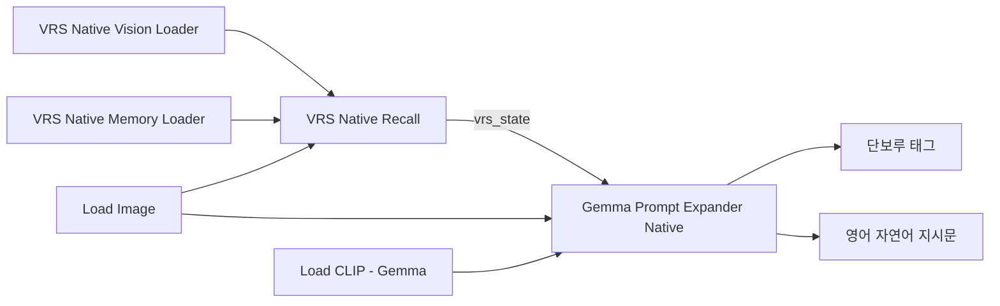

# VRS-INT inside ComfyUI / 네이티브 구축·검색·프롬프트 확장

[한국어 안내](README_KOR.md) · [English overview](README.md) · [두 출력](../PROMPT_EXPANSION.md)

## 한국어

VRS도 **ComfyUI의 PyTorch와 모델 관리**로 실행합니다. 이미지 특징 추출·경험 구축·검색에
llama.cpp, 별도 서버, Transformers, bitsandbytes가 필요 없습니다. Gemma는 참고 자료를
이용해 장면을 확장하고 **단보루 태그 / 영어 자연어 지시문**으로 다듬습니다. 추가 학습은 하지 않습니다.
개인 경험·이미지·모델은 배포하지 않습니다.

### 설치

1. 저장소를 `ComfyUI/custom_nodes/RS-Seasonal-Prompt-Generator`에 둡니다. 네이티브 경로는
   추가 pip 설치 없이 현재 ComfyUI 환경을 사용합니다. torch를 교체하지 마세요.
2. [네이티브 모델 준비](../NATIVE_TIPO.md)에 따라 **ComfyUI 형식의 Gemma 4 E2B safetensors**를
   `ComfyUI/models/text_encoders/`에 둡니다. GGUF/mmproj를 직접 읽지 않습니다.
   VRS 로더는 이 파일에서 `vision_model.*`만 읽습니다. 텍스트·PLE 가중치를 GPU에 올리지 않습니다.
3. 큐가 끝난 뒤 ComfyUI를 재시작합니다. `prompt/VRS` 아래 노드 4개가 나타납니다.
   CUDA GPU와 Gemma 4 비전을 지원하는 ComfyUI가 필요합니다. 실패 시 CPU 추론으로 전환하지 않습니다.

### 처음 경험 만들기 / 묶음 추가

이미지와 태그의 JSONL은 [가상 쌍 예제](../examples/vrs-int/README.md)를 따릅니다.
`image`는 `images_root` 아래 상대 경로입니다. 생성 이미지라면 `source=generated`,
`id=image_sha256`, `rating=u`도 사용할 수 있습니다. 원래 생성 프롬프트는 이미지의 정답이 아닙니다.

1. **VRS Native Vision Loader**에서 Gemma 파일을 선택합니다.
2. `encoder` → **VRS Native Build**의 `encoder`에 연결합니다.
3. `manifest_path`, `images_root`, **새** `store_path`의 절대 경로를 넣습니다.
   처음에는 `base_snapshot`을 비웁니다. `label`은 자유로운 설명입니다.
4. 실행 후 `snapshot`의 64자리 해시를 보관합니다. Build 결과에도 해시·건수·크기가 표시됩니다.
5. 다음 묶음은 같은 저장소와 직전 `base_snapshot`을 지정합니다. 이전 판본과 원본 파일을 보존합니다.

구축은 별도 워크플로로 실행하세요. Build는 명시적인 쓰기 노드이며 제출할 때마다 실행됩니다.
추천 워크플로에 붙이면 원치 않는 재구축이 발생합니다. 중단된 구축은 완성 판본을 게시하지 않지만
사용되지 않은 내용 객체 파일이 남을 수 있습니다. 완성된 기존 판본에는 영향을 주지 않습니다.
[구축 API 예제](../examples/vrs-native-build.api.json)는 경로와 모델명을 바꿔 `/prompt`에 제출하는 형식입니다.
프런트엔드 캔버스 저장 형식은 아닙니다.

### 이미지 → VRS → Gemma 두 출력

- **Memory Loader:** `store_path`와 정확한 `snapshot` 해시를 지정합니다. `CURRENT`가 바뀌었다고
  자동으로 다른 경험을 쓰지 않습니다. 새 판본은 해시를 직접 바꿔 선택합니다.
- **Recall:** 같은 이미지와 요청을 Expander에도 연결합니다. `keep_tags`에는 사용자가 선택한
  이름·외형, `target_tags`에는 바꿀 조건, `exclude_tags`에는 제외할 요소를 쉼표로 구분해 넣습니다.
  한국어 요청 자체는 그대로 전달합니다. 비교 실험에서 영문 정답을 한쪽에만 추가하지 마세요.
- `ratings`는 검색 허용 등급입니다. `u`는 생성 자료의 미분류입니다. 등급은 시각 분류기가 판정하지
  않으므로 원자료 표기를 확인하세요. `neighbors`는 회수 사례 수, `limit`는 후보 태그 수입니다.
- **Expander:** `output_format=both`, `tag_set=danbooru`로 설정하고 `vrs_state`를 연결합니다.
  선택적으로 `tag_knowledge_path`에 개인 한국어 사전을 넣습니다. 파일 `vrs_state_path`와
  노드 상태를 동시에 지정할 수 없습니다. 요청 불일치·명시 조건 충돌·서로 다른 이미지 연결은 오류입니다.
- 후보 이름은 `keep_tags/target_tags`로 선택한 것만 Gemma 참고에 전달합니다. 작가·캐릭터·작품의
  모든 후보와 출처는 경험 및 `report`에 남습니다. 추정 후보를 원작자 판정으로 취급하지 않습니다.
- `tags`, `natural_language`를 각각 Preview as Text 또는 생성 모델의 문자열 입력에 연결합니다.
  Gemma의 CLIP 출력은 이미지 생성 모델용 CLIP이 아닙니다.

[검색·두 출력 API 예제](../examples/vrs-native-recall.api.json)를 제공하며, 모델명·경로·snapshot·이미지명을
실제 값으로 바꾸세요. Recall의 후보 태그·report만 확인하면 Gemma를 연결하지 않아도 됩니다.

### 호환·자원·품질 한계

- **기존 PIL/NF4 경험은 그대로 연결하지 않습니다.** 전처리와 수치 계산이 다르므로 원본 이미지와
  메타데이터에서 작은 별도 네이티브 경험을 먼저 만드세요. 원본 이미지가 없으면 이 경로로 재인코딩할 수 없습니다.
  기존 경험과 CLI는 보존합니다. 계약의 해시를 수동으로 바꿔 우회하지 마세요.
- 비전 가중치는 FP16 보관, 연산은 ComfyUI Gemma의 FP32 `manual_cast` 경로입니다. 가중치 해시,
  구현, torch/torchvision 버전, 전처리·풀링을 계약에 기록합니다. 모델이나 런타임 변경은 재구축을
  요구할 수 있습니다. 동일 차원이라고 호환되는 것은 아닙니다.
- 비전은 약 319MiB의 가중치를 별도 관리합니다. ComfyUI가 GPU 적재와 CPU 오프로드를 제어합니다.
  검색은 제한된 블록만 GPU에 올리지만 **전체 벡터를 순회하는 정확 검색**입니다. 첫 조회는 저장소를
  검증·읽고 이후 조회용 메타데이터와 벡터를 RAM에 보관합니다. 대규모 지연·RAM 사용은 미검증입니다.
- Gemma 확장 노드의 언어 모델 메모리는 별도이며, 로더 두 개의 비전 텐서를 공유하지 않습니다.
  ComfyUI 전체의 CPU 스레드·GPU 선택을 노드가 임의로 변경하지 않습니다.
- 같은 픽셀의 원본/재저장 복사본은 자기 검색에서 제외합니다. 자르기·리사이즈·유사 그림까지
  제거하는 중복 탐지는 아닙니다. IMAGE는 RGB 단일 배치만 받습니다.
- VRS 후보는 검증되지 않은 창작 재료입니다. 자료를 저장해도 인코더가 새로 학습되는 것은 아닙니다.
  한국어 사전·VRS를 붙였다고 행동 보존·표준 태그·장면 일치가 보장되지 않습니다.
- 네이티브 경험의 태그 공간은 현재 단보루입니다. e621 경험 자동 혼합은 지원하지 않습니다.

### 확인한 범위 — 2026-10-14

별도의 실제 ComfyUI 서버/API 실행기에서 **12장 구축 → 4장 추가 → 이미지 검색 → Gemma 두 출력**을
실행했습니다. 같은 그림의 자기 검색 제외, 이전 snapshot 유지, 원본 파일 해시 보존도 확인했습니다.
4070 Ti SUPER에서 단독 비전 한 장의 PyTorch 최대 할당량은 약 425MiB였습니다. 언어 모델·검색 전체의
최대 사용량이나 큰 경험의 처리량은 이 수치에 포함하지 않습니다.

ComfyUI `15eb748b`에서는 한 노드의 두 번째 생성 호출이 이전 CUDA 그래프를 재사용하다 실패했습니다.
각 생성 뒤 ComfyUI의 `cleanup_prefetch_queues`를 호출하도록 고쳤고, CUDA 그래프를 켠 상태로
다시 실행해 두 출력을 확인했습니다. ComfyUI 코어 파일이나 전체 서버 설정을 바꾸지 않습니다.
이는 해당 런타임의 API 실행 검증이며 프런트엔드 캔버스 조작 검증은 아닙니다.

16장 경험과 개발 이미지 한 장의 VRS 유무 비교는 기능 검사입니다. 다른 그림의 머리·눈 특징을
참고 후보에서 가져오는 사례와 비표준 태그가 남아 있습니다. 사전을 함께 쓴 경우에도 표준 태그
표현은 완전하지 않았습니다. 품질 개선이나 속도 향상을 입증한 비교가 아니며, 다음 작업은
검색 후보를 장면에 적용하는 선택 기준과 두 출력의 의미 보존 평가입니다.

## English

Install this repository under ComfyUI custom nodes, prepare the native **Gemma 4 E2B safetensors**
described in [Native TIPO](../NATIVE_TIPO.md), and restart after your queue is idle. No additional
pip dependencies, GGUF, llama.cpp, Transformers, bitsandbytes, or external retrieval server are used.
CUDA and ComfyUI's Gemma 4 vision implementation are required; CPU inference fallback is disabled.

Use **VRS Native Vision Loader → VRS Native Build** in a dedicated build workflow. Supply a local
[image/tag JSONL](../examples/vrs-int/README.md), image root, a new memory directory and an empty
`base_snapshot`. Save the returned snapshot hash. Later batches use the same directory and exact
base hash; original files and earlier versions remain unchanged. Builds run on every submission.
Interrupted builds do not publish a completed snapshot, though unreferenced objects can remain.

For inference, connect Vision Loader, **VRS Native Memory Loader** (directory + exact hash), and
Load Image to **VRS Native Recall**. Connect its `vrs_state`, the **same** image and request, and a
Gemma CLIPLoader to **Gemma Prompt Expander Native**. `both` produces prose first, then tags from
that scene. `keep_tags/target_tags/exclude_tags` are explicit user controls; unselected candidate
names remain in the report but are not passed to the writer. The optional multilingual dictionary
uses `tag_knowledge_path`. Connected states and `vrs_state_path` are mutually exclusive.

The two linked API examples are `/prompt` payloads, not frontend canvas workflow exports. Replace
their placeholder paths/model/snapshot/image. Retrieval alone works without a language model.

**Legacy PIL/NF4 vectors are incompatible.** Re-encode selected original images into a separate
native store. FP16 resident vision weights use ComfyUI's FP32 manual-cast computation. Contracts
fingerprint weights/runtime/preprocessing; do not relabel old vectors as compatible. The vision
loader reads only ~319MiB of vision weights from the full file; the writer's language model is
additional. ComfyUI manages residency/offload, but the two loaders do not share vision tensors.
Retrieval streams bounded GPU blocks and caches vector metadata in RAM; it is a full scan, not
an ANN index. Large-corpus latency/RAM have not been validated. RGB-identical copies are excluded,
but cropped/resized near-duplicates are not. One RGB image per query is supported.

No personal images, metadata, vectors or weights are distributed. Creative relevance and prompt
quality require separate evaluation. This native memory currently uses the Danbooru tag space;
e621 memories are not automatically merged.

**Validation (2026-10-14):** a separate real ComfyUI HTTP executor built 12 observations, appended four,
retrieved an image and generated both outputs on the RTX 4070 Ti SUPER. Original file hashes, older
snapshots and self-exclusion were checked. Single-image vision peaked at ~425MiB of PyTorch allocations;
this excludes the language model and full retrieval. The frontend canvas was not exercised.

On ComfyUI `15eb748b`, two generations within one node initially reused a stale CUDA graph. Generation
now calls ComfyUI's prefetch-queue cleanup between calls; the repeated run passed with CUDA graphs
enabled, without modifying ComfyUI core or global flags. The small off/on comparison does not establish
better quality or speed: neighbor appearance can leak into the subject, and nonstandard tags remain,
including when dictionary hints are present. Large memories still need a performance evaluation.
